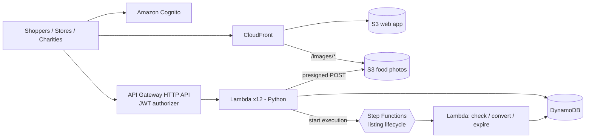

# 🍎 FoodLoop

**Buy Smart. Share Surplus. Waste Less.**

FoodLoop is a serverless platform for Sri Lanka that connects supermarkets, bakeries, restaurants and food producers with
shoppers and charities. Stores list surplus food at a discount (**Smart Deal**) or for free (**Donation**). When a sale ends,
**AWS Step Functions automatically turns unsold stock into a free donation** for verified charities - so less food is thrown
away and more people can afford to eat well.

Built for the AWS Builder Center weekend challenge **"No Pipeline, No Problem"**: serverless services only, deployed by hand with the SAM CLI.

## What it does
- **Smart Deals** - discounted surplus with a sale deadline; shoppers reserve online and pay at the store.
- **Free Donations** - verified charities and community groups reserve free food.
- **Automatic discount-to-donation conversion** - opt in per listing; leftover stock becomes a donation, never past its best-before time.
- **Pickup codes** - customers show a short code (e.g. `FL-K7M4Q`); store staff verify it on their dashboard.
- **Built for Sri Lanka** - LKR prices, all 25 districts, Asia/Colombo times, WhatsApp contact links, English / සිංහල / தமிழ் switcher, mobile-first and light on data.
- **Trust** - businesses and charities can be admin-approved before they publish or reserve donations.
- **Impact counters** - items rescued, items donated, rupees saved.

## Architecture

More detail (data model, state machine, security): [`docs/ARCHITECTURE.md`](docs/ARCHITECTURE.md).

## Quick start
Prerequisites: AWS account + CLI, [SAM CLI](https://docs.aws.amazon.com/serverless-application-model/latest/developerguide/install-sam-cli.html), Node 20+, Python 3.13.
```bash
pip install -r requirements-dev.txt && pytest -q      # 37 tests
./scripts/deploy.sh                                   # deploys to ap-south-1 and prints the site URL
./scripts/seed.py --stack foodloop --region ap-south-1 --demo
```
Full step-by-step guide, demo script and submission checklist: [`CLAUDE.md`](CLAUDE.md).

## Tech
React + Vite + Tailwind · Python 3.13 on AWS Lambda (arm64) · API Gateway (HTTP API) · DynamoDB · S3 + CloudFront · Step Functions (Standard) · Cognito · AWS SAM.

## Project layout
`template.yaml` (all infrastructure) · `workflows/` (state machine) · `backend/` (Lambdas) · `frontend/` · `tests/` · `scripts/` · `docs/`

## Real-world notes
Demo stores are fictional; FoodLoop is not affiliated with any retailer. See [`docs/ROLLOUT_SRI_LANKA.md`](docs/ROLLOUT_SRI_LANKA.md)
for the pilot plan and the legal/food-safety items to confirm before going live.
