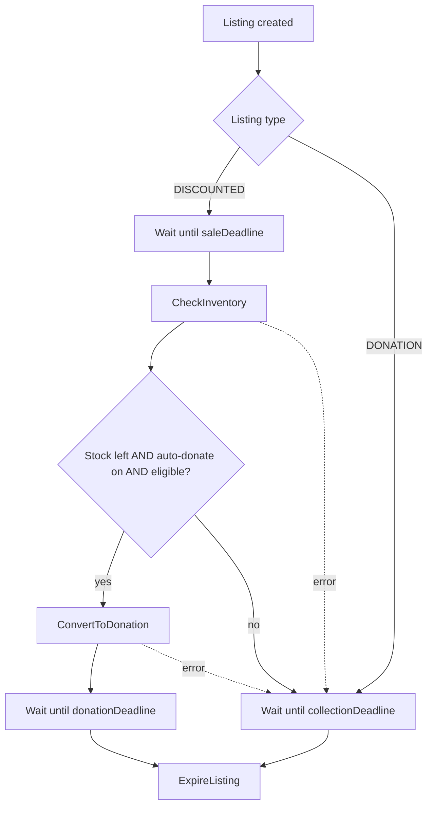

# FoodLoop architecture

## Services and why serverless fits
| Service | Used for |
|---|---|
| S3 + CloudFront | React app (private bucket via Origin Access Control) and food photos served from `/images/*` |
| API Gateway (HTTP API) | REST endpoints, Cognito JWT authorizer, throttling (burst 50 / 25 rps), CORS |
| Lambda (Python 3.13, arm64) | All business logic; one function per responsibility with least-privilege IAM |
| DynamoDB (on-demand) | Listings, Reservations, Profiles, Impact counters; point-in-time recovery on the main tables |
| Step Functions (Standard) | One execution per listing: waits for deadlines without a running server, then converts / expires |
| Cognito | Sign-up / sign-in, JWTs; `admin` group |

## Listing lifecycle (state machine: `workflows/listing_lifecycle.asl.json`)

Eligibility (`check_inventory`): listing is an open discount, quantity > 0, opted in, `donationDeadline` in the future and **not after `bestBeforeDate`**.
Standard workflows can wait up to a year, so deadlines never need a polling server (Express workflows stop at five minutes).

## Data model
**Listings** `listingId` (PK) · GSI `ByStatus` (status, createdAt) · GSI `ByOwner` (ownerId, createdAt)
`listingType` DISCOUNTED|DONATION, `originalPrice`, `discountedPrice`, `totalQuantity`, `availableQuantity`, `collectedQuantity`,
`saleDeadline`, `collectionDeadline`, `donationDeadline`, `bestBeforeDate`, `autoDonateRemaining`, `maxPerCustomer`, `status` ACTIVE|EXPIRED,
`convertedFromDiscount`, `imageKey`, denormalised store details (`orgName`, `orgDistrict`, `orgAddress`, `orgWhatsapp`), `sfnExecutionArn`.

**Reservations** `reservationId` (PK) · GSI `ByUser` · GSI `ByListing` · GSI `ByPickupCode`
`quantity`, `unitPrice`, `originalUnitPrice`, `pickupBy` (snapshot), `pickupCode`, `reservationStatus` RESERVED|COLLECTED|CANCELLED|NO_SHOW, product/store snapshot.

**Profiles** `userId` (Cognito `sub`) - `role` CUSTOMER|BUSINESS|CHARITY, `status` ACTIVE|PENDING|APPROVED|REJECTED, contact + organisation details.
**Impact** single item `metric=global` with atomic counters `itemsRescued`, `itemsDonated`, `lkrSaved`.

## Consistency and safety
- Reserve / cancel / pickup are DynamoDB **transactions** with conditional expressions - no oversell, no double collection.
- Pickup codes are random from an unambiguous alphabet; "unknown code" and "another store's code" return the same error.
- Image upload uses a **presigned POST policy** pinning the key, content type and size (max 3 MB); the images bucket is private and only readable through CloudFront.
- Listings are hidden from the public API once past their reserve deadline even if a workflow is delayed.
- Failed `start_execution` rolls back the listing, so there is never a listing without a lifecycle.

## Security notes
Identity only from the validated JWT; role and verification status only from the Profiles table; request bodies limited to 20 KB; strict input validation;
no secrets in the repo; Cognito password policy 8+ with upper/lower/number; API throttling enabled.
