<!--
DRAFT for the AWS Builder Center article. Written for: AWS Builder Center readers and challenge judges (not necessarily Sri Lankan, not all expert in AWS).
Before publishing:
1. Reconcile the TITLE prefix, TAG and required sections with the OFFICIAL challenge page (not confirmed when this was written).
2. Replace every [bracket]: demo video link, AWS console screenshots (aws-*.png, see AWS_CONSOLE_SCREENSHOTS.md), real cost numbers if you quote any.
3. Builder Center needs images uploaded: upload each file from docs/screenshots/ where the article shows it (paths are relative to the docs folder).
4. The GitHub repo must be PUBLIC when you submit.
Everything marked "tested" below was actually run against the live deployment on 16 Nov 2026 (see SMOKE_TEST_REPORT.md).
-->

# Weekend Challenge: No Pipeline, No Problem: FoodLoop - Buy Smart. Share Surplus. Waste Less.

**Live app:** https://de9dfsc26bz0s.cloudfront.net  ·  **Code:** https://github.com/nimeshayasith/FoodLoop  ·  **Demo video (3 min):** [video link]

**Try it:** sign in with `customer@foodloop.example`, `shop@foodloop.example` or `charity@foodloop.example` (password in the README; demo accounts only).

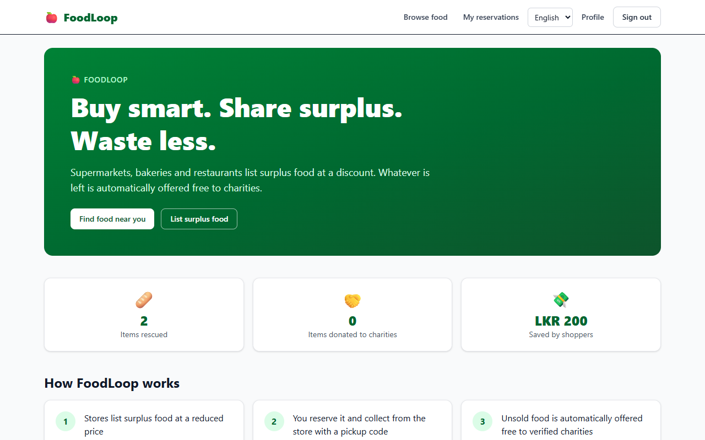

## The problem
Every evening, bakeries, supermarkets and restaurants in Sri Lanka are left with food they cannot sell: bread, rice packets, fruit.
Most of it is thrown away. At the same time, food prices keep rising and many families watch every rupee, and charities and community kitchens
depend on donations that arrive irregularly.

Two problems, one solution: **good food that nobody bought could be sold cheaply first, and given away free if it is still left.**
The hard part is doing that on time, every time, without someone at the shop watching a clock.

## The solution: FoodLoop
FoodLoop is a web app where stores post surplus food in two ways:

- **Smart Deal** - discounted food with a deadline. Example: 100 bread packets at LKR 100 instead of LKR 200. Shoppers reserve online and pay at the shop.
- **Free Donation** - food offered free to verified charities and community groups.

The feature I am proudest of: **automatic discount-to-donation conversion.** When a shop posts a Smart Deal it can tick
"Donate unsold items automatically". When the sale ends, FoodLoop checks what is left and, if it is still safe to eat, turns the leftovers into a free
donation that charities can reserve. Nobody has to remember to do anything.

### How it works for each person
| Who | What they do |
|---|---|
| **Shopper** | Browses deals near them, reserves, gets a short **pickup code** (like `FL-V45YK`), pays at the store |
| **Store** | Posts a listing with a photo, sees reservations, types the shopper's code to confirm the handover |
| **Charity** | Reserves free donations (only verified charities can) |
| **Admin** | Approves businesses and charities |

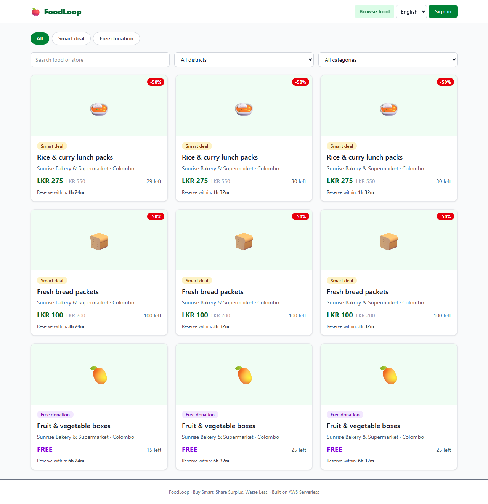

## Screenshots: the whole journey

**1. A shopper reserves 2 bread packets.** Stock drops from 100 to 98 and a pickup code appears.

| Listing | Pickup code |
|---|---|
| 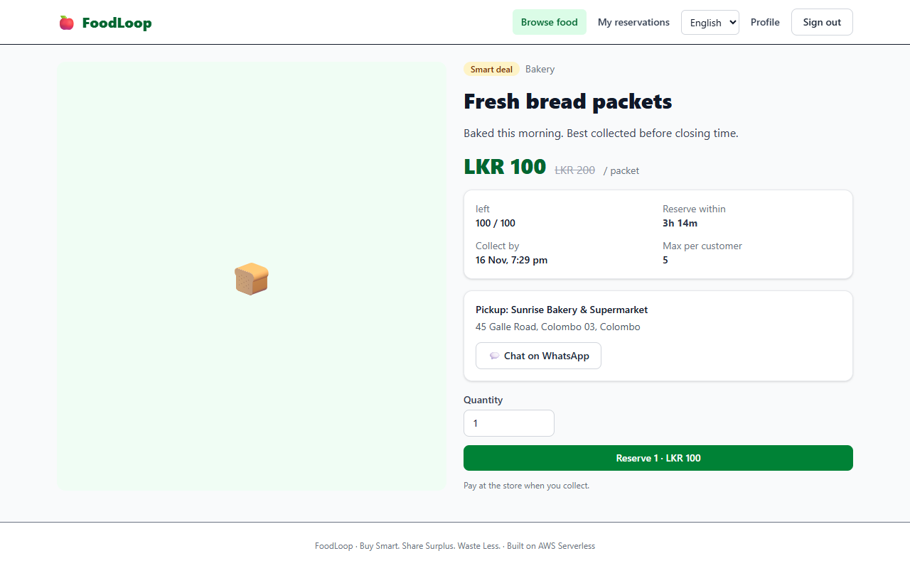 | 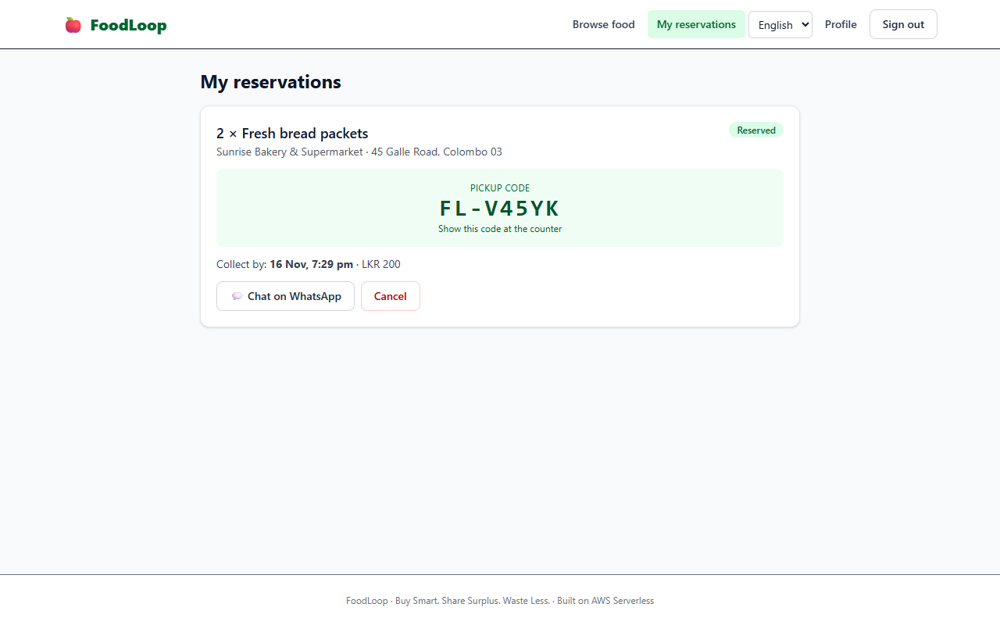 |

**2. The store sees the reservation and confirms the handover with the code.**

| Store dashboard | Verify a pickup |
|---|---|
| 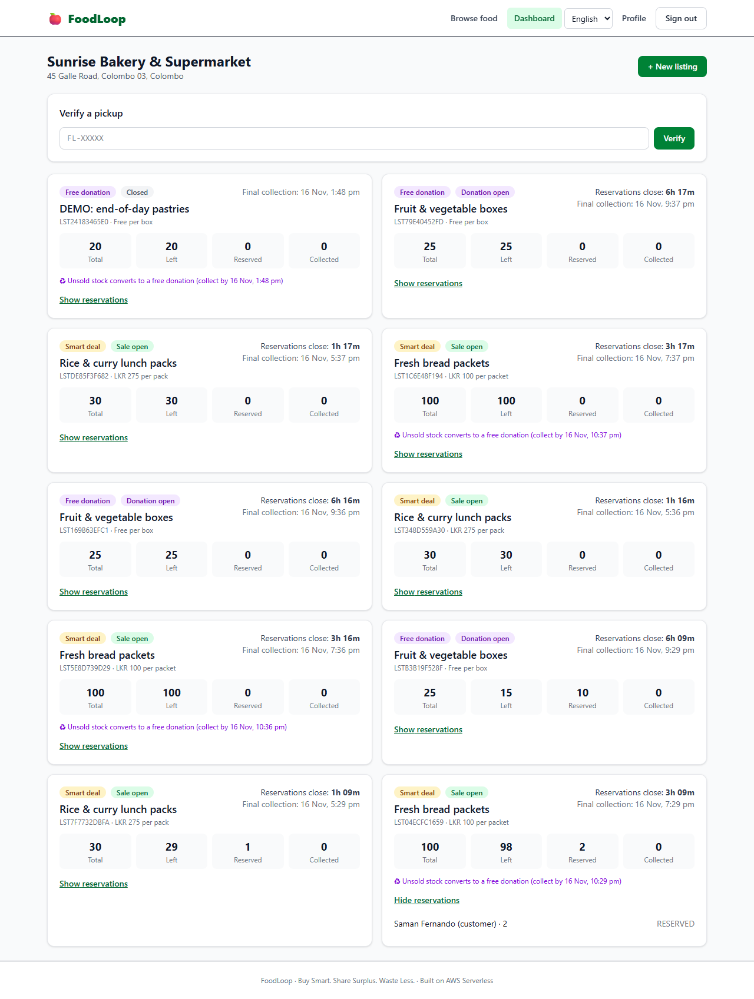 | 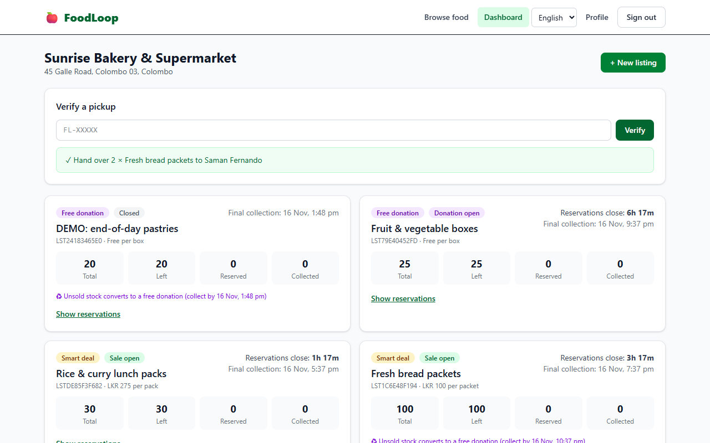 |

**3. The store posts a new listing with a photo.** The "Demo timings" button sets a 2-minute sale, so the workflow can be shown live.

| New listing form | Photo served through CloudFront |
|---|---|
| 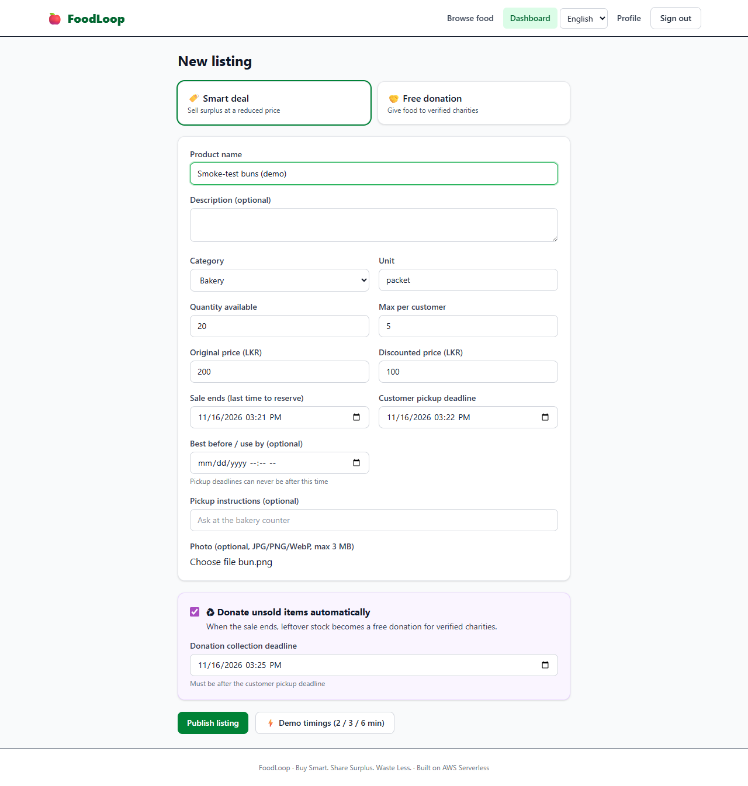 | 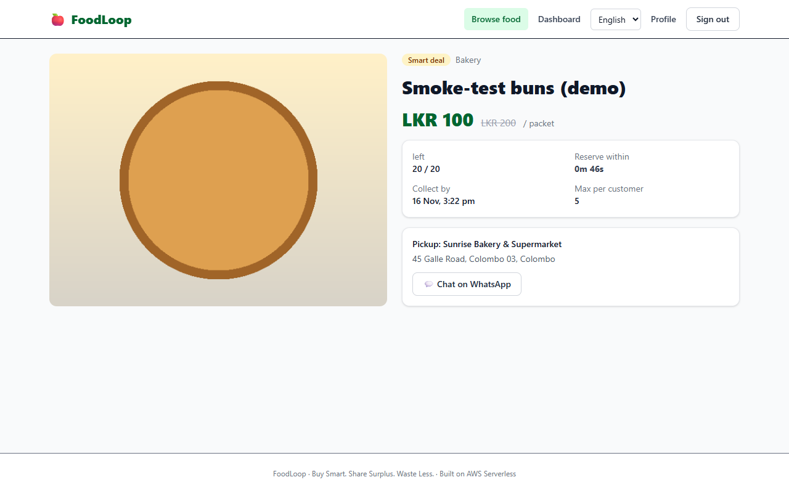 |

**4. The sale ends. FoodLoop converts the leftovers by itself.** The same listing is now a free donation, a charity reserves 8 of the 20.

| Converted donation | Charity reservation |
|---|---|
| 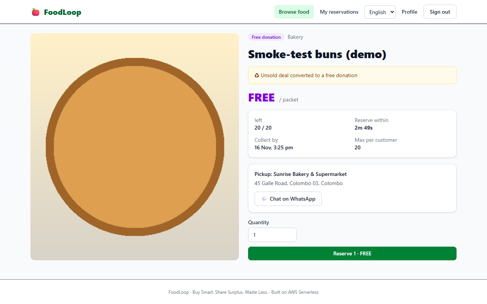 | 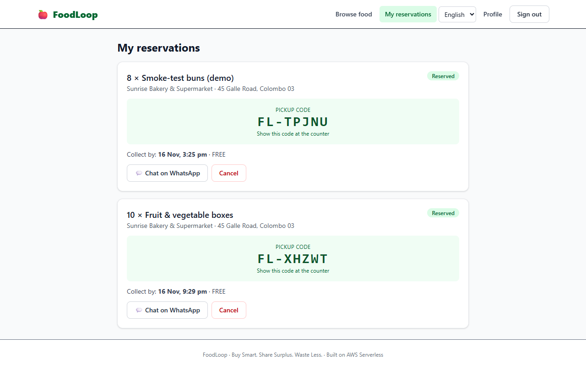 |

**5. Behind the scenes in the AWS Console.**


*[Add caption: the finished execution - Wait, CheckInventory, ConvertToDonation, Wait, ExpireListing.]*


*[Add caption: one execution per listing, most are waiting for a deadline.]*


*[Add caption: the listing is now a DONATION, price 0, converted = true.]*

**6. Made for Sri Lanka.** English, Sinhala (සිංහල) and Tamil (தமிழ்); phone-friendly.

| Sinhala | Mobile |
|---|---|
| 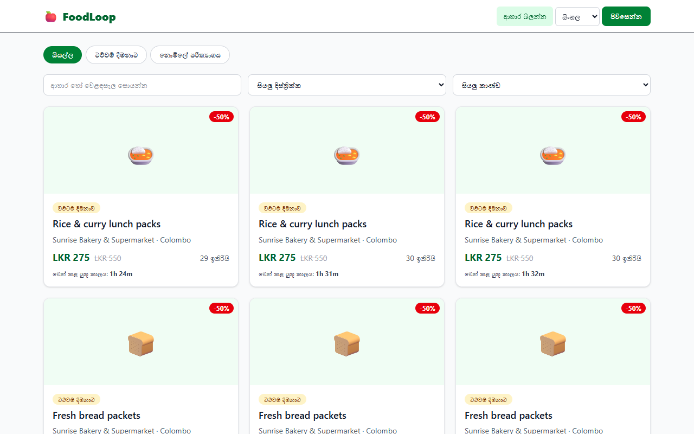 |  |

## Architecture
Everything is serverless and defined in **one AWS SAM template** (`template.yaml`). I deployed it by hand with the SAM CLI: **no servers and no CI/CD pipeline**, as the challenge asks.

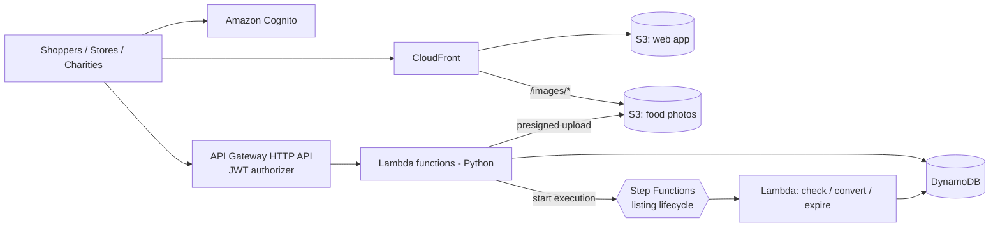

| AWS service | What it does in FoodLoop |
|---|---|
| **S3 + CloudFront** | Hosts the React website and serves food photos from private buckets |
| **API Gateway (HTTP API)** | The public API; checks the login token (JWT) before any private call |
| **Lambda (Python 3.13, arm64)** | All the logic: listings, reservations, pickup checks, admin, and the three workflow steps |
| **DynamoDB** | Listings, reservations, profiles and impact counters (pay-per-request) |
| **Step Functions (Standard)** | One workflow per listing; waits for deadlines, checks stock, converts, closes |
| **Cognito** | Sign-up, sign-in, and an `admin` group |

### The heart of it: the listing workflow
When a store publishes a listing, a Lambda saves it and starts a Step Functions execution named after the listing.

```
Wait until sale deadline  ->  CheckInventory  ->  stock left and opted in?
      yes -> ConvertToDonation -> Wait until donation deadline -> ExpireListing
      no  -> Wait until collection deadline -> ExpireListing
```

Why Step Functions? A Standard workflow can **wait up to a year at no compute cost**. There is no server polling a clock, and no Lambda sits idle
waiting for a timestamp. In my live test the conversion fired **about one second after the sale deadline**, and the whole 2-minute-sale lifecycle finished in 5 minutes 4 seconds.

## Decisions that make it trustworthy
- **No overselling.** If two shoppers tap "reserve" on the last packets at the same moment, only one wins. A reservation is a single DynamoDB transaction that lowers the stock *only if enough is left* and saves the reservation in the same step.
- **Food safety first.** No pick-up or donation deadline can be after the item's best-before time, and the rule is checked again when the conversion runs.
- **Trust.** Businesses and charities can be approved by an admin before they publish or reserve donations. (The demo runs with auto-approve so judges can try everything.)
- **Identity comes only from the login token.** The server never trusts a user id or role from the request. In my test, a shopper's token was refused with HTTP 403 when trying to reserve a donation, create a listing or verify a pickup.
- **Direct photo upload.** Photos go from the browser straight to S3 through a presigned upload that fixes the file name, type and size (max 3 MB). They never pass through Lambda.
- **No TTL for business logic.** DynamoDB TTL deletes are late and unpredictable, so Step Functions owns the closing of a listing.
- **Cheap to run.** On-demand DynamoDB, arm64 Lambda and a static frontend. [Add real cost numbers if you measured them. Do not claim "free" without checking the Billing page.]

## What I tested
I ran the full journey on the live site in private browser windows (details and evidence: `docs/SMOKE_TEST_REPORT.md`):
home and browse, filters, language switch, shopper reservation (stock 100 -> 98), store pickup verification (and a second try correctly refused),
charity-only rule in both the UI and the API, photo upload through CloudFront, and the automatic conversion with a 2-minute demo listing.
The backend also has **37 automated tests** (validation, role rules, pickup codes, the no-oversell guarantee and the whole lifecycle), and the template passes `sam validate --lint`.

**Honest limits:** sign-up with a real email inbox was tested only up to the code screen (I confirmed a test user through the admin API); Sinhala and Tamil are draft translations
that need a native speaker; there are no online payments (shoppers pay in store); and there is one region and no WAF.

## What I learned
- **Step Functions is the right tool for "do something later".** Waiting until a timestamp is what Standard workflows are made for, and the execution history gives you a free audit trail.
- **Transactions beat checks.** Checking stock and then writing it is a race. Putting the condition inside the DynamoDB write removes the race.
- **One SAM template is a real "no pipeline" strategy.** `sam build` and `sam deploy` from a laptop is repeatable, and the same template builds the tables for my tests, so tests and cloud cannot drift apart.
- **Test on the real cloud, not just mocks.** The live run found things mocks never would: my PC clock was 103 seconds behind AWS, which would have made the "2-minute" demo button last about 15 seconds. Deadlines should come from the server's clock.
- **Design for slow networks.** In Sri Lanka many users are on mobile data. Small pages, a static frontend and clear loading states matter.
- **Windows needs care.** Git Bash rewrites paths like `/index.html`, which broke the CloudFront invalidation until I set `MSYS_NO_PATHCONV=1` in the deploy script.

## What's next
A pilot with a few independent bakeries and one community kitchen, native-speaker review of Sinhala and Tamil, local payment options, pickup reminders,
and notifying nearby charities the moment a donation appears.

The demo stores are fictional; FoodLoop is not affiliated with any retailer.

**Try it:** https://de9dfsc26bz0s.cloudfront.net  ·  **Code:** https://github.com/nimeshayasith/FoodLoop  ·  **Video:** [video link]

---

### Video outline (3 minutes) - see `docs/DEMO_SCRIPT.md` for the full script
1. **0:00** The problem: surplus food thrown away while prices rise.
2. **0:25** Store posts a listing with a photo and turns on "Donate unsold items automatically" (Demo timings).
3. **0:55** Shopper reserves and gets a pickup code; stock drops.
4. **1:25** Step Functions graph: waiting, then CheckInventory -> ConvertToDonation.
5. **2:10** Charity reserves the converted donation; the store verifies a pickup; counters rise.
6. **2:35** Architecture diagram and close: serverless, one template, no pipeline.
